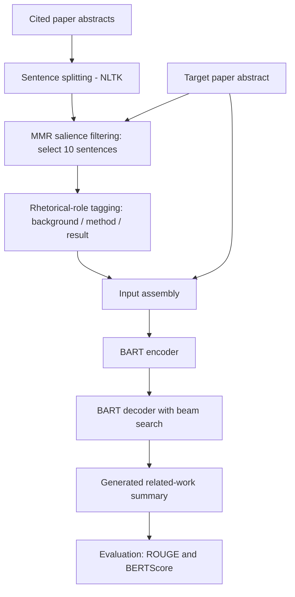

# Multi-Document Abstractive Summarization of Research Papers

A pipeline that generates **related-work paragraphs** from a paper's abstract and the abstracts of the works it cites. It fine-tunes BART on the [Multi-XScience](https://github.com/yaolu/Multi-XScience) dataset and tests whether preparing the input better, along with using a larger model, improves the output.


## Highlights

The best model (v3: BART-large with target-aware, MMR-filtered, role-tagged input) improves on the flat-input baseline on all four metrics:

| Metric | Baseline | v3 | Relative change |
|---|---:|---:|---:|
| ROUGE-1 | 0.2802 | **0.3269** | +16.7% |
| ROUGE-2 | 0.0493 | **0.0700** | +42.0% |
| ROUGE-L | 0.1609 | **0.1816** | +12.9% |
| BERTScore | 0.8476 | 0.8507 | +0.4% |

## The problem

Writing a related-work section means reading many papers and explaining how they connect. Feeding every cited abstract into a standard summarizer doesn't work well, for several reasons:

- **Length:** inputs average about 778 words, which is more than the encoder's limit, so later cited abstracts get cut off.
- **Redundancy:** cited papers often repeat similar background.
- **No query:** a model that sees only the cited papers doesn't know what the target paper is about.
- **Abstractiveness:** about 82% of the bigrams in the reference summaries don't appear in the source text, so copying sentences isn't enough.

## Pipeline



1. **Preprocessing:** removes author prefixes and `@cite_N` markers, drops empty abstracts, and flattens each record to `target_abstract`, `cited_abstracts` and `gold_summary`.
2. **MMR salience filtering:** embeds sentences with Sentence-BERT (`all-MiniLM-L6-v2`), uses the target abstract as the query, and keeps 10 sentences (λ = 0.7) in their original order.
3. **Rhetorical-role tagging:** a keyword-cue classifier labels each sentence as background, method or result.
4. **Query conditioning:** places the full target abstract at the start of the input.
5. **Generation:** a fine-tuned BART model writes the summary using beam search.

The final input looks like this:

```text
<target> {target abstract} <background> {sentences} <method> {sentences} <result> {sentences}
```

## Model versions

| Version | Model | Target abstract | Sentence selection | Role tags | Input length | Repetition block + length penalty | Training examples |
|---|---|:-:|:-:|:-:|---:|:-:|---:|
| Baseline | BART-base | No | None | No | 512 | No | 3,000 |
| v1 | BART-base | No | None | Yes | 512 | No | 3,000 |
| v2 | BART-base | Yes | MMR (10) | Yes | 768 | Yes | 3,000 |
| Scaling control | BART-base | Yes | MMR (10) | Yes | 768 | Yes | 20,000 |
| v3 | BART-large | Yes | MMR (10) | Yes | 768 | Yes | 20,000 |

All versions decode with 4 beams and a 128-token output limit. Where enabled, the repetition block is `no_repeat_ngram_size=3` and the length penalty is `1.2`.

## Results

All models were evaluated on the same first 300 test examples.

| Model | ROUGE-1 | ROUGE-2 | ROUGE-L | BERTScore |
|---|---:|---:|---:|---:|
| Baseline (flat input) | 0.2802 | 0.0493 | 0.1609 | 0.8476 |
| v1 (role tags) | 0.2838 | 0.0517 | 0.1647 | 0.8488 |
| v2 (target + MMR + tags) | 0.2970 | 0.0582 | 0.1689 | **0.8515** |
| Scaling control (v2 on 20,000 examples) | 0.2941 | 0.0579 | 0.1685 | 0.8512 |
| v3 (v2 setup on BART-large) | **0.3269** | **0.0700** | **0.1816** | 0.8507 |

### What the comparisons show

- **Role tags (baseline to v1):** all metrics rose slightly. This is the only comparison where a single factor changed.
- **Target abstract, MMR, longer input and decoding settings (v1 to v2):** this was the largest gain among the BART-base runs, but all four changes were made together, so their separate effects aren't known.
- **More data (v2 to scaling control):** going from 3,000 to 20,000 examples gave no measurable benefit on BART-base.
- **Larger model (scaling control to v3):** this was the largest ROUGE gain, at +0.0328 on ROUGE-1. The runs also differed in numerical precision.
- **BERTScore:** the differences among v2, the scaling control and v3 (at most 0.0008) are too small to rank them.

### Limitations

- Each configuration was trained once and tested on 300 examples, so no significance testing was done.
- The role classifier is rule-based: 30.4% of sentences matched no cue and defaulted to background.
- Cited papers are represented only by their abstracts, so details found only in the full text aren't available.
- Absolute scores remain modest for this task.

## Dataset

[Multi-XScience](https://github.com/yaolu/Multi-XScience) is built from arXiv papers, with citation information from the Microsoft Academic Graph.

| Split | Full size | Used for 3,000-example runs | Used for 20,000-example runs |
|---|---:|---:|---:|
| Train | 30,369 | 3,000 | 20,000 |
| Validation | 5,066 | 300 | 1,000 |
| Test | 5,093 | 300 | 300 |

The training subset was limited by available compute. The validation set was used only to monitor loss during training.

## Repository structure

| File / folder | Description |
|---|---|
| `main.ipynb` | Data loading, preprocessing, baseline and v1 training, evaluation |
| `bart-large.ipynb` | v3 (BART-large) training and evaluation |
| `processed_train.json`, `processed_val.json`, `processed_test.json` | Preprocessed dataset splits |
| `*_results.json` | Saved evaluation scores |
| `saved_models/` | Fine-tuned checkpoints (not uploaded because of size; available on request) |

## Getting started

**Requirements:** Python 3.10 and a CUDA GPU. BART-base trained on a 4 GB GPU. BART-large needed more memory, so it was trained on a Kaggle cloud GPU with about 15 GB.

```bash
git clone https://github.com/rm2110/multi-doc-res-paper-summarizer.git
cd multi-doc-res-paper-summarizer

git clone https://github.com/yaolu/Multi-XScience.git

pip install transformers datasets torch sentencepiece accelerate rouge-score bert-score sentence-transformers nltk
python -c "import nltk; nltk.download('punkt'); nltk.download('punkt_tab')"
```

Then:

1. Check that the train, validation and test files are in `Multi-XScience/data/`.
2. Run the preprocessing cells in `main.ipynb` to create the `processed_*.json` files.
3. Run the training cells for the version you want. Use `bart-large.ipynb` for v3.
4. Run the generation and evaluation cells.

### Training settings

| Setting | BART-base runs | BART-large (v3) |
|---|---|---|
| Optimizer | AdamW | AdamW |
| Learning rate | 3e-5 | 3e-5 |
| Batch size | 4 | 4 |
| Epochs | 3 | 3 |
| Weight decay | 0.01 | 0.01 |
| Precision | Mixed (FP16) | Full (FP32) |
| Gradient checkpointing | No | Yes |

The BART-base run on 20,000 examples took about 10 hours, and the BART-large run took about 18 hours.

> **BART-large tip:** load the model with `torch_dtype=torch.float32`. The checkpoint otherwise loads in float16, which caused mixed-precision errors and NaN losses during this project.

## Tech stack

Python · PyTorch · Hugging Face Transformers and Datasets · Sentence-Transformers · NLTK · rouge-score · bert-score

## Future work

- Train variants that each add a single v2 component, to measure its individual contribution.
- Repeat each configuration with several random seeds and evaluate on the full test set, to allow significance testing.
- Replace the keyword rules with a rhetorical-role classifier trained on annotated abstracts, such as CSAbstruct.
- Train BART-large on the full 30,369-example training set.
- Use full-text sections of cited papers instead of abstracts alone.

## References

- Lewis et al. (2020). [BART: Denoising Sequence-to-Sequence Pre-training for Natural Language Generation, Translation, and Comprehension](https://aclanthology.org/2020.acl-main.703/). ACL.
- Lu, Dong & Charlin (2020). [Multi-XScience: A Large-scale Dataset for Extreme Multi-document Summarization of Scientific Articles](https://aclanthology.org/2020.emnlp-main.648/). EMNLP.
- Carbonell & Goldstein (1998). The Use of MMR, Diversity-Based Reranking for Reordering Documents and Producing Summaries. SIGIR.
- Reimers & Gurevych (2019). [Sentence-BERT: Sentence Embeddings using Siamese BERT-Networks](https://aclanthology.org/D19-1410/). EMNLP-IJCNLP.
- Lin (2004). [ROUGE: A Package for Automatic Evaluation of Summaries](https://aclanthology.org/W04-1013/). Text Summarization Branches Out.
- Zhang et al. (2019). [BERTScore: Evaluating Text Generation with BERT](https://arxiv.org/abs/1904.09675). arXiv:1904.09675.
